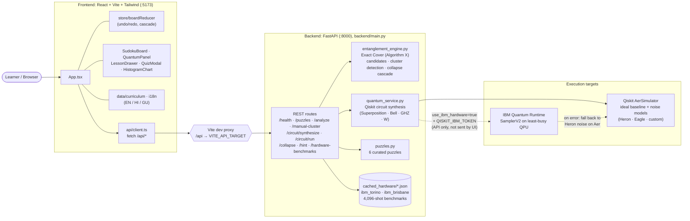

# Qudoku — Interactive Quantum Sudoku Learning Platform

Built for the **IBM Qiskit Fall Fest 2026 – Quantum for Humanity Hackathon (Track 3: Education)**, **Qudoku** transforms a 9×9 Sudoku puzzle into a live quantum constraint sandbox backed by real **Qiskit** circuits and an Exact Cover implication solver.

## Quantum-to-Sudoku Mapping

| Quantum Concept | Sudoku Constraint Structure | Qiskit Circuit Synthesis |
| :--- | :--- | :--- |
| **Superposition** | Empty cell with $k$ legal candidates $\{d_1, \dots, d_k\}$ | Equal superposition $\|\psi\rangle = \frac{1}{\sqrt{k}}\sum \|d_i\rangle$ via `H` / `StatePreparation` |
| **Bell State ($\|\Psi^+\rangle$)** | Two peer cells sharing $\{a, b\}$ or a 2-cell conjugate link | `H(q0) -> CX(q0, q1) -> X(q1)` |
| **GHZ State ($\|\text{GHZ}_n\rangle$)** | Bivalue $\{a, b\}$ implication chain across $n \ge 3$ cells | `H(q0) -> CX(q0, q1..q_{n-1})` + parity `X` gates |
| **W-State ($\|W_n\rangle$)** | Exactly-one-hot digit $d$ restricted to $n$ cells in a house | Iterative `X(0)` + `CRY(θ_i)` + `CX` cascade |
| **Hardware Noise** | Decoherence & readout bit-flips leaking into invalid states | `qiskit-aer` IBM Heron / Eagle noise models + cached 4,096-shot QPU benchmarks |

## Architecture

```text
Qudoku/
├── backend/
│   ├── main.py                  # FastAPI routes & CORS setup
│   ├── entanglement_engine.py   # Generic Exact Cover (Algorithm X) + Implication Solver
│   ├── quantum_service.py       # Dynamic Qiskit circuit synthesis, Aer noise & Sampler
│   ├── puzzles.py               # Curated tutorial & sandbox 9x9 puzzles
│   ├── cached_hardware/         # Pre-run IBM Quantum Eagle/Heron benchmark JSONs
│   ├── tests/                   # Pytest unit & API integration tests
│   └── Dockerfile
├── frontend/
│   ├── src/
│   │   ├── api/                 # Typed REST client
│   │   ├── components/          # SudokuBoard, QuantumPanel, LessonDrawer, QuizModal, HistogramChart
│   │   ├── data/                # Structured curriculum lessons & quizzes
│   │   ├── i18n/                # Translations: English, Hindi (हिन्दी), Gujarati (ગુજરાતી)
│   │   ├── store/               # Board reducer (Auto vs. Manual entanglement, undo/redo, cascade)
│   │   └── types/               # TypeScript interfaces for Grid, Clusters, Circuits, Lessons
│   ├── package.json
│   ├── package-lock.json
│   └── Dockerfile
├── .env.example
├── .gitignore
├── docker-compose.yml
├── requirements.txt
└── LICENSE
```

### Architecture Diagram



**Request flow for "Measure & Collapse":** `App.tsx` → `api.collapseCluster()` → `POST /api/collapse` → `run_cluster_circuit()` (Aer, optional noise) → sampled bitstring → `apply_measurement_collapse()` (forced-single cascade) → updated board and trace returned to the UI. The cluster itself comes from an earlier `/api/analyze` or `/api/manual-cluster` call and is sent back in the request body.

## Quickstart

### 1. Environment (Optional)
Copy `.env.example` to `.env` if you want to configure an optional IBM Quantum token (`QISKIT_IBM_TOKEN`) for live hardware execution. Without a token, all circuits run locally on `Qiskit AerSimulator`.

- Docker Compose reads `.env` automatically.
- The backend does not load `.env` itself, so for a local run export the token in your shell first: `export QISKIT_IBM_TOKEN=...`.
- Live hardware is only used when a request sets `use_ibm_hardware=true` on `/api/circuit/run`. The bundled UI does not send this flag, so the UI always runs on Aer.

### 2. Backend (Python 3.11+ / FastAPI / Qiskit)
Run these from the **repository root** (the app is imported as `backend.main`).
```bash
python3 -m venv .venv
# Windows: .venv\Scripts\activate  |  macOS/Linux: source .venv/bin/activate
python -m pip install -r requirements.txt
python -m uvicorn backend.main:app --reload --port 8000
```
Use `python -m uvicorn` (not a bare `uvicorn`) so the server runs with the virtual environment's interpreter. A globally installed `uvicorn` will fail with `ModuleNotFoundError: No module named 'fastapi'`.

Verify with `http://127.0.0.1:8000/api/health`; interactive API docs are at `http://127.0.0.1:8000/docs`.

### 3. Frontend (React + Vite + Tailwind)
Requires Node.js 20+ (the Docker image uses Node 22). In a second terminal:
```bash
cd frontend
npm ci
npm run dev
```
Open `http://localhost:5173`. Vite proxies `/api/*` requests to `http://127.0.0.1:8000`, so start the backend first. Use `npm ci` rather than `npm install` to install exactly what `package-lock.json` specifies without rewriting it.

### 4. Docker Compose
```bash
docker compose up --build
```

### 5. Run Tests & Production Build
```bash
python -m pytest backend/tests -v
cd frontend && npm run build
```

## API Endpoints

| Method | Endpoint | Purpose |
| :--- | :--- | :--- |
| `GET` | `/api/health` | Service and Qiskit/Exact-Cover engine health check |
| `GET` | `/api/puzzles` | List all 6 curated tutorial and sandbox 9×9 puzzles |
| `POST` | `/api/analyze` | Validate board, compute Exact Cover uniqueness, candidates, and auto-detected clusters |
| `POST` | `/api/manual-cluster` | Validate and build a custom user-selected `BELL`, `GHZ`, `W`, or `SUPERPOSITION` cluster |
| `POST` | `/api/circuit/synthesize` | Generate Qiskit circuit diagram, gate counts, depth, and OpenQASM 2.0 |
| `POST` | `/api/circuit/run` | Execute circuit on Qiskit Aer (ideal or Heron/Eagle/custom noise) or IBM Runtime |
| `POST` | `/api/collapse` | Sample measurement outcome and apply Sudoku collapse cascade |
| `POST` | `/api/hint` | Return next forced/Exact-Cover cell hint |
| `GET` | `/api/hardware-benchmarks` | Load cached 4,096-shot IBM Eagle (`ibm_brisbane`) and Heron (`ibm_torino`) benchmarks |

## Features
- **Auto & Manual Entanglement Modes**: Automatically detect Bell, GHZ, and W-state constraint clusters on any board state, or manually select cells on the grid to synthesize custom entangled registers.
- **Measure & Collapse Cascade**: Execute live Qiskit Aer circuits and collapse entangled clusters directly onto the Sudoku board with step-by-step forced-single propagation traces.
- **Noise & IBM QPU Benchmarks**: Switch between Ideal Qiskit Aer, IBM Heron r2 noise, IBM Eagle r3 noise, a custom decoherence slider, and pre-run cached 4,096-shot benchmarks from `ibm_torino` and `ibm_brisbane`.
- **Multilingual Curriculum**: Full UI, 5 interactive lessons, and 5 concept quizzes in **English**, **Hindi (हिन्दी)**, and **Gujarati (ગુજરાતી)**.

## License
Licensed under the [Apache-2.0 License](./LICENSE).
