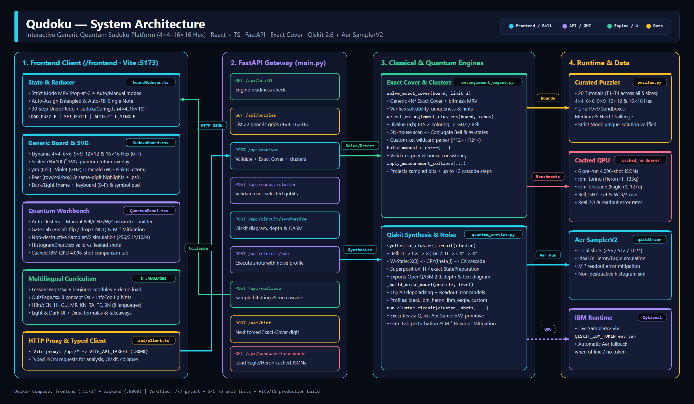
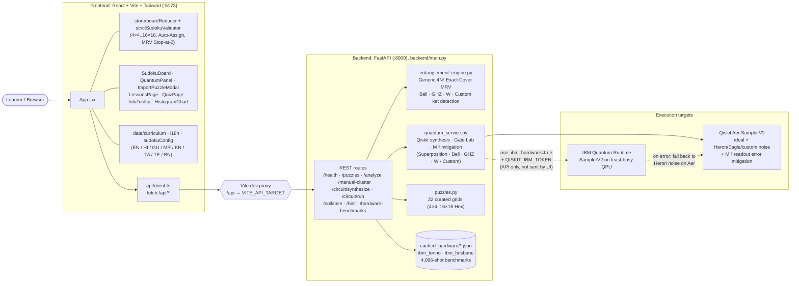

# Qudoku — Interactive Generic Quantum Sudoku Learning Platform

Built for the **IBM Qiskit Fall Fest 2026 – Quantum for Humanity Hackathon (Track 3: Education)**, **Qudoku** turns generic **$N \times N$ Sudoku** (`4×4`, `6×6`, `9×9`, `12×12`, and `16×16 Hexadecimal`) into an interactive quantum computing sandbox powered by **Qiskit 2.6 + Aer `SamplerV2` primitives**, tensor-product **Readout Error Mitigation ($M^{-1}$)**, live gate perturbations, and a fast classical **Exact Cover / MRV Stop-at-2** solver.



---

## Quantum-to-Sudoku Mapping

| Quantum Concept | Sudoku Constraint Structure | Qiskit Circuit Synthesis |
| :--- | :--- | :--- |
| **Single-Cell Superposition (`Inspect \|ψ⟩`)** | Empty cell with $k$ legal candidates $\{s_1, \dots, s_k\}$ | Equal superposition $\|\psi\rangle = \frac{1}{\sqrt{k}}\sum \|s_i\rangle$ on $\lceil \log_2 k \rceil$ qubits (`H` / decomposed `StatePreparation`) |
| **Bell State ($\|\Psi^+\rangle$)** | Two peer cells sharing $\{a, b\}$ or a 2-cell conjugate link | `H(q0) -> CX(q0, q1)` + parity `X` gates |
| **GHZ State ($\|\text{GHZ}_n\rangle$)** | Bivalue $\{a, b\}$ implication chain across $n \ge 3$ cells | `H(q0) -> CX(q0, q1..q_{n-1})` + parity `X` gates |
| **W-State ($\|W_n\rangle$)** | Exactly-one-hot symbol $s$ restricted to $n$ cells in a house | Iterative `X(0)` + `CRY(θ_i)` + `CX` cascade |
| **Custom Ket Superposition** | User-defined kets with wildcards (e.g. `\|123> + \|132>` or `\|*12> + \|12*>`) | Per-cell minimal binary encoding + normalized `StatePreparation` |
| **Gate Lab & Readout Mitigation** | Live `+ X(q0)` bit-flip, `Drop CNOT` unentanglement, and $M^{-1}$ readout inversion | Executed through `qiskit_aer.primitives.SamplerV2` with Heron/Eagle/Custom noise models |

> **Pedagogical Design:** Running a Qiskit circuit simulates quantum measurement probabilities **non-destructively**—individual random shots do not overwrite the Sudoku board. Deterministic solving automations (**Auto-Assign Entangled** and **Auto-Fill Single Note**) only fill cells when Sudoku logic uniquely forces them.

---

## Key Features

- **5 Generic Grid Sizes (22 Built-in Boards) & Sudoku.com Cell Highlights:** Dual **Board Size** and **Tutorial / Board** selectors provide Tutorials 1–4 (**Superposition**, **Bell Pairs**, **GHZ Chains**, **W-States**) across **`4×4`** (`2×2` boxes), **`6×6`** (`2×3`), **`9×9`** (`3×3`, plus 2 Sandboxes), **`12×12`** (`3×4`, `1–9, A–C`), and **`16×16 Hex`** (`4×4`, `0–9, A–F`), complete with Sudoku.com-style row, column, and sub-box peer highlighting plus matching-number/symbol highlighting on filled cells.
- **Auto & Manual Entanglement Workbench:** Automatically detect Bell, GHZ, and W-state constraint clusters, inspect single empty cells (`Inspect |ψ⟩`), or pick arbitrary cells to synthesize **Bell**, **GHZ**, **W**, or **Custom** ket circuits.
- **Light & Dark Modes + Beginner Tooltips:** Switch cleanly between high-contrast **Dark Mode** and **Light Mode** from the header (persisted in `localStorage`), with hover/focus **`InfoTooltip`** descriptions explaining controls, quantum concepts, and solver options for first-time learners.
- **Live Qiskit `SamplerV2` + Gate Lab + Readout Mitigation ($M^{-1}$):** Choose `256 / 512 / 1024` shots, switch between Ideal Aer, **IBM Heron r2**, **IBM Eagle r3**, or custom decoherence, toggle **Gate Lab** perturbations (`+ X(q0)` bit-flip or `Drop CNOT`), and apply $M^{-1}$ readout error mitigation to watch constraint fidelity recover in real time.
- **Cached 4,096-Shot IBM QPU Benchmarks:** Side-by-side comparison against pre-run benchmark JSONs modeled/collected for **`ibm_torino`** (Heron r1, 133q) and **`ibm_brisbane`** (Eagle r3, 127q).
- **Client-Side Strict Mode Validator & Custom Upload:** Paste strings, row grids, or JSON arrays (`.txt`, `.sdk`, `.sdm`, `.json`) of any supported size (`4×4`–`16×16 Hex`). Runs pre-validation duplicate checks plus a sub-6ms **MRV Stop-at-2** solver to reject zero-solution or ambiguous puzzles and highlight conflicting/ambiguous cells.
- **8-Language Beginner Curriculum (Track 3: Education):** Full UI, tooltips, full-page **6-module Lessons** (`LessonsPage`), and **8-question Quiz** (`QuizPage`) in **English (`EN`)**, **Hindi (`हिन्दी`)**, **Gujarati (`ગુજરાતી`)**, **Marathi (`मराठी`)**, **Kannada (`ಕನ್ನಡ`)**, **Tamil (`தமிழ்`)**, **Telugu (`తెలుగు`)**, and **Bengali (`বাংলা`)**, with automatic `sessionStorage` resume history.

---

## Classical Baseline, Error Mitigation & Scaling Analysis ($N$ Increases)

To uphold scientific honesty alongside quantum pedagogy, Qudoku benchmarks its **classical MRV Exact Cover solver** against **Qiskit `SamplerV2`** circuits across all five board sizes (`512` shots on Tutorial 2 Bell pairs):

| Grid Size ($N$) | Sub-Box | Empty Cells | Naive Space ($N^{N^2}$) | Classical Exact Cover MRV | Qubit Budget ($\text{Bell} / \lceil \log_2 N \rceil$) | Heron Noise Raw → $M^{-1}$ Mitigated | Eagle Noise Raw → $M^{-1}$ Mitigated |
| :---: | :---: | :---: | :---: | :---: | :---: | :---: | :---: |
| **$4 \times 4$** | $2 \times 2$ | 11 | $4^{16} \approx 4.3 \times 10^9$ | **0.16 ms** | 2q / 2q | 96.5% → **99.4%** | 95.1% → **98.2%** |
| **$6 \times 6$** | $2 \times 3$ | 22 | $6^{36} \approx 1.0 \times 10^{28}$ | **0.35 ms** | 2q / 3q | 96.3% → **98.4%** | 95.5% → **99.0%** |
| **$9 \times 9$** | $3 \times 3$ | 32 | $9^{81} \approx 2.0 \times 10^{77}$ | **0.48 ms** | 2q / 4q | 97.7% → **99.6%** | 94.9% → **100.0%** |
| **$12 \times 12$** | $3 \times 4$ | 74 | $12^{144} \approx 2.4 \times 10^{155}$ | **2.00 ms** | 2q / 4q | 97.7% → **99.0%** | 94.7% → **99.8%** |
| **$16 \times 16$** | $4 \times 4$ | 128 | $16^{256} \approx 1.8 \times 10^{308}$ | **5.62 ms** | 2q / 4q | 97.9% → **99.6%** | 94.1% → **99.2%** |

### How Quantum Advantage Emerges as $N$ Increases (and Today's NISQ Reality)
1. **NP-Completeness & Search Explosion:** Generalizing $N \times N$ Sudoku is **NP-complete**. While constraint propagation and MRV pruning solve structured boards with $N \le 16$ in $< 6\text{ ms}$, sparse or adversarially crafted instances force classical backtracking into exponential branching $\mathcal{O}(c^m)$ over $m$ unfixed variables as $N$ grows.
2. **Logarithmic State Compression & Coherent Constraint Encoding:** A single classical cell requires testing up to $N$ symbols sequentially, whereas a quantum register represents all $N$ candidates coherently in only $\lceil \log_2 N \rceil$ qubits (`4` qubits suffice for all `16` hexadecimal symbols, `7` qubits for `100×100`). Entangled Bell/GHZ/W sub-circuits preserve correlated constraint branches simultaneously in superposition.
3. **Asymptotic Speedup via Grover Amplitude Amplification:** In an unstructured search over $K$ remaining sub-board assignments (for instance after classical propagation stalls on $b$ unfixed binary decisions, $K = 2^b$), **Grover's algorithm** achieves a provable quadratic query speedup—requiring $\mathcal{O}(\sqrt{K}) = \mathcal{O}(2^{b/2})$ oracle calls instead of $\mathcal{O}(K) = \mathcal{O}(2^b)$ classically. As $N$ scales into dense combinatorial regimes where classical MRV hits deep backtracking trees, reducing the exponent base ($2^b \to 2^{b/2}$) yields orders-of-magnitude fewer oracle evaluations.
4. **Honest NISQ Crossover Reality:** On today's noisy quantum processors (`IBM Eagle r3`, `IBM Heron r1/r2`), multi-qubit Grover oracles and QAOA layers incur two-qubit gate and readout errors before reaching large fault-tolerant $N$. Therefore, **Qudoku uses classical Exact Cover for instant validation/solving**, while leveraging small-qubit subgraphs (`2–6` qubits) and **readout error mitigation ($M^{-1}$)** to teach learners *why* entanglement, noise, and fault-tolerant scaling matter.

---

## Architecture

```text
Qudoku/
├── backend/
│   ├── main.py                  # FastAPI routes, Pydantic schemas, CORS
│   ├── entanglement_engine.py   # Generic 4×4..16×16 Exact Cover MRV + Bell/GHZ/W/Custom clusters
│   ├── quantum_service.py       # Qiskit circuit synthesis, Aer SamplerV2, Gate Lab & M⁻¹ mitigation
│   ├── puzzles.py               # 22 verified puzzles (Tutorials 1–4 across 5 sizes + 2 9×9 sandboxes)
│   ├── cached_hardware/         # Pre-run 4,096-shot IBM Eagle (ibm_brisbane) & Heron (ibm_torino) JSONs
│   ├── tests/                   # Pytest unit & FastAPI integration suite
│   └── Dockerfile
├── frontend/
│   ├── src/
│   │   ├── api/                 # Typed REST client (/api/*)
│   │   ├── components/          # SudokuBoard, QuantumPanel, ImportPuzzleModal, LessonsPage, QuizPage, InfoTooltip, HistogramChart
│   │   ├── data/                # Structured curriculum (6 beginner lessons & 8 quiz questions)
│   │   ├── i18n/                # Full translations (EN, HI, GU, MR, KN, TA, TE, BN)
│   │   ├── store/               # Board reducer (auto-assign entangled, single-note cascade, undo/redo)
│   │   ├── types/               # TypeScript definitions
│   │   └── utils/               # sudokuConfig, strictSudokuValidator (MRV Stop-at-2), sessionStorage
│   ├── tests/                   # Zero-dependency Node + esbuild TypeScript unit tests
│   └── Dockerfile
├── docs/
│   ├── Qudoku_Architecture.svg  # Editable vector system diagram
│   ├── Qudoku_Architecture.png  # Rendered high-res architecture diagram
│   └── Qudoku_Presentation.pptx # Hackathon pitch deck
├── .env.example
├── docker-compose.yml
├── requirements.txt             # Exact pinned Python/Qiskit package versions
└── LICENSE                      # Apache-2.0
```

### Architecture Diagram



**Request flow for "Run Qiskit Circuit":** `App.tsx` / `QuantumPanel.tsx` → `api.runCircuit()` → `POST /api/circuit/run` → `synthesize_cluster_circuit()` (with optional `gate_override`) → `AerSamplerV2` (optional noise + `M⁻¹` readout mitigation) → counts, fidelity, QASM, and circuit diagram returned non-destructively to the UI (board cells are never overwritten by random shots).

---

## Quickstart & Verification

- Docker Compose reads `.env` automatically.
- The backend does not load `.env` itself, so for a local run export the token in your shell first: `export QISKIT_IBM_TOKEN=...`.
- Live hardware is only used when a request sets `use_ibm_hardware=true` on `/api/circuit/run`. The bundled UI does not send this flag, so the UI always runs locally on Qiskit Aer `SamplerV2`.

### 1. Backend (Python 3.11+ / FastAPI / Qiskit)
Run these from the **repository root** (the app is imported as `backend.main`).
```bash
python3 -m venv .venv
# Windows: .venv\Scripts\activate  |  macOS/Linux: source .venv/bin/activate
python -m pip install -r requirements.txt
python -m uvicorn backend.main:app --reload --port 8000
```
Use `python -m uvicorn` (not a bare `uvicorn`) so the server runs with the virtual environment's interpreter. Verify with `http://127.0.0.1:8000/api/health`; interactive API docs are at `http://127.0.0.1:8000/docs`.

### 2. Frontend (React + Vite + Tailwind)
Requires Node.js 20+ (the Docker image uses Node 22). In a second terminal:
```bash
cd frontend
npm ci
npm run dev
```
Open `http://localhost:5173`. Vite proxies `/api/*` requests to `http://127.0.0.1:8000`, so start the backend first. Use `npm ci` rather than `npm install` to install exact dependencies from `package-lock.json`.

### 3. Docker Compose
```bash
docker compose up --build
```

### 4. Run All Tests & Production Build
```bash
# Backend unit & API integration tests (pytest)
python -m pytest backend/tests -v

# Frontend TypeScript unit tests & production build
cd frontend && npm test && npm run build
```

---

## API Endpoints

| Method | Endpoint | Purpose |
| :--- | :--- | :--- |
| `GET` | `/api/health` | Service and `qiskit-aer + exact-cover` health check |
| `GET` | `/api/puzzles` | List all 22 curated `4×4`, `6×6`, `9×9`, `12×12`, and `16×16 Hex` puzzles |
| `POST` | `/api/analyze` | Validate board, compute Exact Cover uniqueness, candidates, and auto-detected clusters |
| `POST` | `/api/manual-cluster` | Build & validate custom `BELL`, `GHZ`, `W`, or `CUSTOM` ket registers |
| `POST` | `/api/circuit/synthesize` | Generate Qiskit circuit diagram, gate counts, depth, and OpenQASM 2.0 |
| `POST` | `/api/circuit/run` | Execute via `SamplerV2` (`ideal`, `ibm_heron`, `ibm_eagle`, `custom`, `gate_override`, `mitigate_readout`) |
| `POST` | `/api/collapse` | Sample outcome and simulate forced-single collapse trace |
| `POST` | `/api/hint` | Return next Exact-Cover cell hint for any supported board size |
| `GET` | `/api/hardware-benchmarks` | Load cached 4,096-shot IBM Eagle (`ibm_brisbane`) and Heron (`ibm_torino`) benchmarks |

---

## Quick Learner Validation Log (Track 3: Education)
Use the table below during live demos / mentor checks to record quick learner tests (recommended: 3–5 learners complete `Tutorial 1–2` + the 8-question quiz in their preferred language):

| Learner | Language Used | Pre-Quiz Familiar? | Post-Quiz Score | Time Spent | Key Takeaway / Feedback |
| :---: | :---: | :---: | :---: | :---: | :--- |
| Learner 1 | EN / HI / GU / MR / KN / TA / TE / BN | _Record during test_ | `/ 8` | `~5 min` | _e.g. Bell anti-correlation clicked via 4×4 board_ |
| Learner 2 | EN / HI / GU / MR / KN / TA / TE / BN | _Record during test_ | `/ 8` | `~5 min` | _e.g. Gate Lab X-flip clearly showed invalid `\|00⟩`/`\|11⟩`_ |
| Learner 3 | EN / HI / GU / MR / KN / TA / TE / BN | _Record during test_ | `/ 8` | `~5 min` | _e.g. Native regional UI + tooltips lowered math barrier_ |

---

## License
Licensed under the [Apache-2.0 License](./LICENSE).
